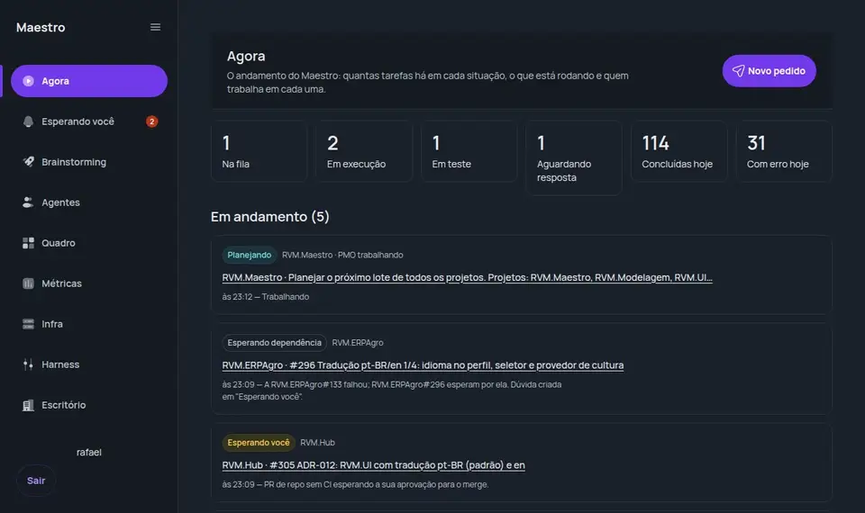

A casa estava arrumada: custo zero enquanto não há cliente, código numa forja própria, o GitHub
virando arquivo. Tudo no lugar.

Só que tinha uma coisa que nenhuma arrumação resolvia: **eu continuava sendo o maestro de cada sessão.**

Era eu quem abria o terminal no projeto certo, colava o pedido, esperava, lia o resultado, abria outro terminal para
revisar, lembrava de rodar o teste de tela, voltava ao primeiro para pedir o ajuste. A máquina já verificava sozinha
(capítulo 6), mas quem regia a orquestra, instrumento por instrumento, ainda era eu. E maestro que também carrega as
partituras e afina os violinos não rege nada direito.

## O que o emprego novo me mostrou

No capítulo 0 eu contei que o emprego novo me colocou no meio de gente que usa IA em escala, com processo. Três coisas
que vi lá viraram a base do que vem a seguir.

**Primeiro: tudo no Linux.** Eu trabalhava no Windows, e cada script tinha duas versões, cada ferramenta um
comportamento. Migrei o ambiente inteiro para o WSL, o Linux que roda dentro do Windows. Agora o meu computador e os
meus servidores falam a mesma língua. O mesmo comando que eu testo em casa roda igual no servidor, sem tradução.

**Segundo: uma fonte única de instruções.** Cada ferramenta de IA queria o seu arquivo de instruções, e eles
envelheciam cada um num ritmo. Hoje cada repositório tem um único `AGENTS.md`, que qualquer ferramenta lê. O arquivo
específico do Claude tem uma linha só: "leia o AGENTS.md". Mudou a regra? Muda num lugar.

**Terceiro: IA com papel, não um chat que faz tudo.** Esse foi o que mais mudou o jogo.

## Seis papéis, cada um com o seu modelo

Um agente que planeja, programa, revisa e testa tende a fazer as quatro coisas mais ou menos, e a concordar consigo
mesmo no final. Então separei o trabalho em seis papéis, cada um com instruções, permissões e **modelo de IA fixos**:

| Papel | O que faz | Modelo | O que não pode |
|---|---|---|---|
| **Arquiteto** | Discute especificação e arquitetura comigo | o mais forte | Rodar comando ou escrever código |
| **PMO** | Transforma o pedido numa tarefa com plano e critério de validação | o mais leve | Programar |
| **Desenvolvedor** | Implementa, escreve os testes, abre o pull request | o intermediário | Insistir: duas tentativas sem CI verde, para e me chama |
| **Revisor** | Lê o código procurando bug real | **de outro fornecedor** | Alterar o código que revisa |
| **QA** | Roda os testes no navegador e tira o print da tela | o intermediário | Mexer no código da aplicação |
| **DevOps** | Lê os servidores e diagnostica | o mais forte | Mudar infraestrutura sem aprovação |

O modelo fixo por papel não é capricho. Transformar um pedido em tarefa não precisa do modelo mais caro; decidir se
uma mudança de servidor é segura precisa. E, como tudo roda por assinatura (capítulo 8), o custo de errar essa
escolha não aparece na fatura: aparece no tempo. Um script confere se cada papel está com o modelo combinado, para
ninguém trocar sem perceber.

O detalhe de que mais me orgulho é o **Revisor de outro fornecedor**. O código é escrito pelo Claude e revisado por um
modelo da OpenAI, pelo Codex. Quem escreveu tende a ler o próprio código confirmando a própria lógica. Outro modelo,
treinado de outro jeito, tropeça em coisas diferentes. Vale para gente também: autor não revisa o próprio trabalho. É como pedir para o sogro avaliar o churrasco que você
fez: ele vai achar defeito, e às vezes ele tem razão.

E as **permissões vêm do perfil**, não da boa vontade do agente. O Desenvolvedor roda num perfil de projeto que
simplesmente não tem acesso a servidor: se ele precisa de um log de produção, não tem como contornar, só pode parar e
pedir. É o estagiário que não recebe a senha do servidor de produção no primeiro dia. Nem no segundo. O DevOps lê qualquer servidor, mas toda escrita vira um pedido de aprovação com o comando exato. Nenhum agente
roda com alguém na conversa para perguntar: quando precisa de mim, ele termina a sessão devolvendo a dúvida, com
opções, e espera a resposta chegar pela fila.

## O Maestro

Papéis definidos resolvem metade. A outra metade é quem chama cada um, na ordem certa, e guarda o que depende de mim.
Esse é o **Maestro**.

Eu já tinha tentado isso uma vez, com um projeto chamado Cockpit: um painel para acompanhar sessões de IA. A
especificação cresceu, foi repactuada, e no começo de outubro percebi que estava desenhando a coisa errada. Eu não
precisava de um painel para assistir às sessões. Precisava de alguém para **conduzi-las**. O Cockpit foi substituído
pelo Maestro em 4 de outubro, e no dia seguinte o repositório nasceu.

O fluxo de uma tarefa hoje é este:

1. Eu mando o pedido, do terminal ou do painel.
2. O Maestro descobre a qual projeto ele pertence e chama o **PMO**, que escreve a tarefa como issue na forja.
3. O **Desenvolvedor** implementa e abre o pull request.
4. O **Revisor** lê o diff. Achou problema sério? Volta para o Desenvolvedor.
5. CI verde, merge em `dev`, deploy, e o **QA** abre a tela no navegador e tira o print.
6. A tarefa chega para mim com o link, o status e o screenshot.

E tudo o que precisa de mim cai num lugar só: uma **fila única**, que no painel se chama "Esperando você". Dúvida de
escopo, aprovação de mudança de infraestrutura, promoção para produção. Quando aparece algo novo, o aviso chega no
Telegram, com botões para responder dali mesmo.

Antes, as perguntas da IA estavam espalhadas em seis terminais abertos. Parecia grupo de família no WhatsApp: todo
mundo falando ao mesmo tempo e ninguém respondendo o que eu perguntei. Agora estão numa fila, com contexto, esperando
a minha vez, e não o contrário.

## O Maestro se constrói sozinho (quase)

A parte que ainda me diverte: **o Maestro é desenvolvido pelos papéis que ele orquestra.** É a
orquestra afinando o próprio maestro. Por enquanto, ninguém pediu aumento. Assim que a primeira versão
ficou de pé, as tarefas do próprio Maestro passaram a ser issues na forja, implementadas pelo Desenvolvedor, revisadas
pelo Revisor, testadas pelo QA. Eu aprovo a tela.

A especificação foi fechada entre 3 e 4 de outubro. Em pouco mais de uma semana, sete das oito etapas do roteiro
estavam em produção: o serviço central, o painel, um executor no servidor e outro no meu computador, o agente DevOps
com a página de infraestrutura e uma auditoria semanal das próprias instruções.

E não é só o código que melhora sozinho. As instruções que os agentes seguem, o **harness** (regras, skills e
memórias), também passam por uma faxina toda semana. No domingo, uma rodada automática procura o que envelheceu:
caminho de arquivo que não existe mais, branch já mergeada que continua sendo citada, regra repetida em dois lugares,
skill que ninguém usa, instrução fixa que passou do tamanho combinado. E lê as memórias que cada projeto acumulou: o
que um agente aprendeu num projeto e serve para todos sobe para as instruções globais, e o próximo agente já começa
sabendo. A rodada não muda nada por conta própria. Ela abre um pull request, e eu aprovo ou recuso. É a retrospectiva
que ninguém precisa marcar, e onde ninguém fica na defensiva.

## O que ainda não está pronto

Seria desonesto parar aqui.

A oitava etapa, **abrir um projeto novo inteiro pelo Maestro**, do pedido até o primeiro deploy, ainda está em
construção. Hoje, projeto novo ainda nasce numa conversa comigo.

E a fila tem os seus tropeços. Neste mês, uma trava que deveria segurar a promoção para produção conferia o trecho
errado do histórico: olhava o que ia de `dev` para `stg`, e não o que ia de `stg` para `prd`. Duas mudanças chegaram à
produção antes do meu "aprovado". Eram mudanças que eu aprovaria, e aprovei depois, mas a lição é a mesma do capítulo
7: **um freio que você nunca viu segurar não é freio.** A trava foi corrigida para conferir exatamente o que vai subir.

E o aviso pelo Telegram já saiu do papel: aprovo tarefas pelo celular do mesmo jeito que aprovo pelo painel web.

## O que eu levaria para qualquer equipe

1. **Papel antes de ferramenta.** Defina o que cada agente faz e, principalmente, o que ele não pode fazer. A
   permissão tem que estar no ambiente, não no texto do pedido.
2. **Escolha o modelo pelo papel.** Nem todo trabalho precisa do modelo mais forte; o julgamento sim.
3. **Revisor de outra família.** Autor e revisor do mesmo modelo concordam demais.
4. **Uma fila para o humano.** Se as perguntas da IA chegam por seis lugares, você vira o gargalo de novo, só que com
   mais abas abertas.

Não faz um ano, eu estava preenchendo um cadastro de motorista de aplicativo. Hoje uma equipe de agentes trabalha na
fila enquanto eu escrevo este texto. Acho que chegou a hora de olhar para trás e ver o caminho inteiro. É o que faço no
último capítulo.

*Rafael Veneroso Morici · rvmtech.com.br*
